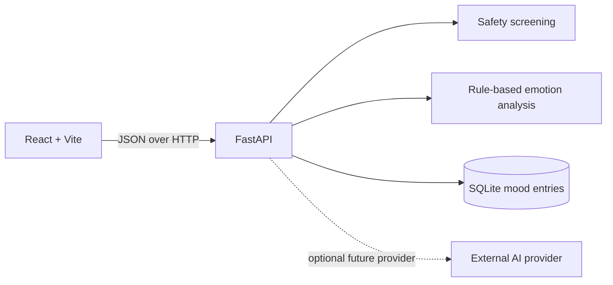
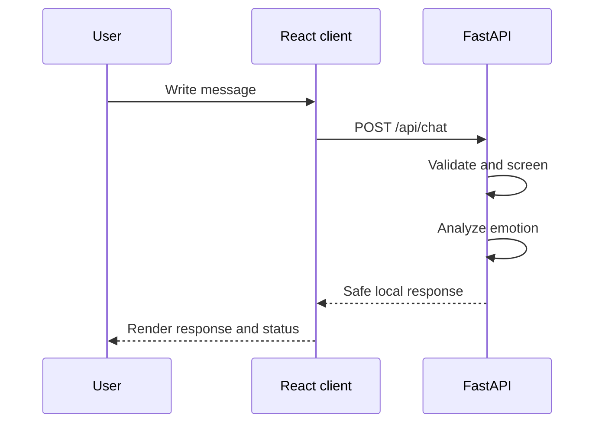
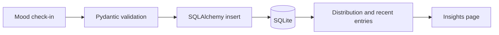
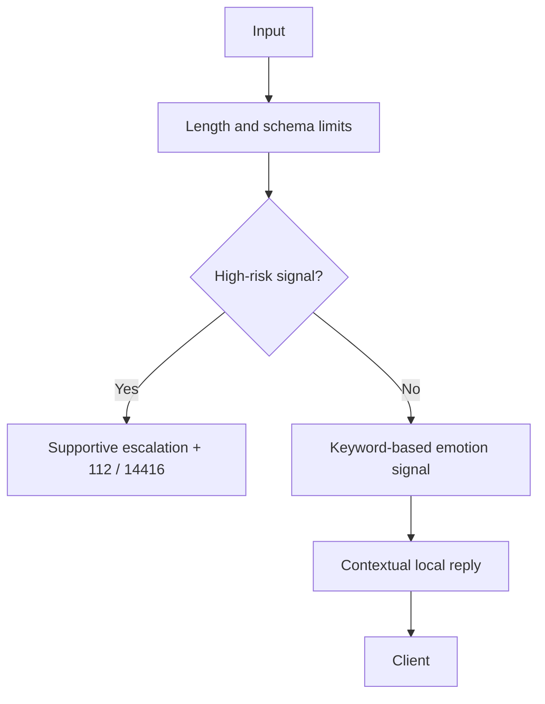
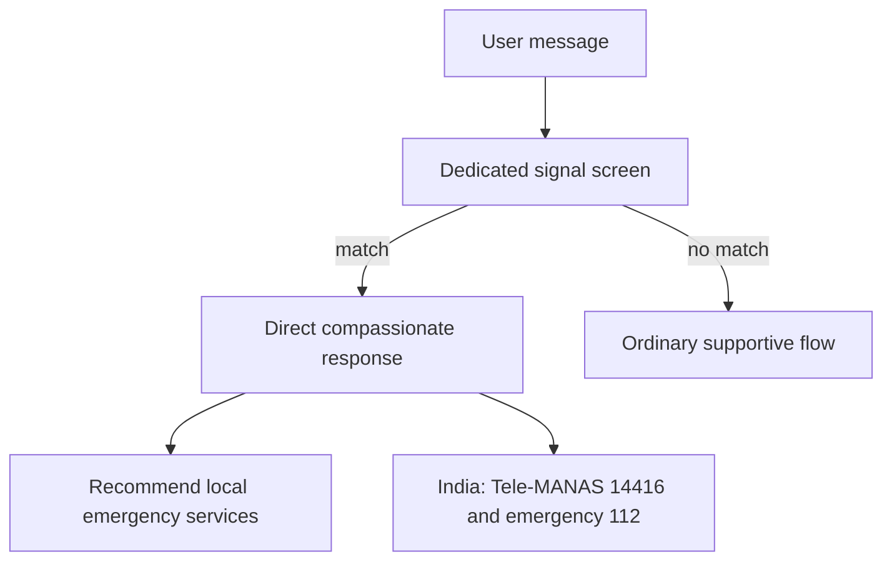

# Technical design

## Requirements and responsibilities

F.R.I.E.N.D. is a local-first emotional reflection application. The React client owns navigation and interaction state. FastAPI owns validation, safety screening, local emotion heuristics, and persistence. SQLite stores only user-created mood entries. Chat requests are not persisted.

## Architecture

## Request-response flow

## Mood data flow

## AI and response safety

## Crisis escalation

## API examples

`POST /api/chat` with `{"message":"I feel stressed"}` returns an emotion label, a local response, and a safety escalation boolean. `POST /api/moods` accepts one of eight mood labels and an optional 2,000-character journal. `GET /api/moods/summary` returns counts and five recent entries.

## Security, privacy, and trade-offs

Inputs are bounded and external credentials are never sent to the browser. CORS is restricted to local Vite hosts. The demo has no accounts and therefore does not provide identity isolation: the SQLite file is local to the server process and must be protected by the operator. The keyword safety screen is intentionally conservative and imperfect; it is not a professional assessment. The optional provider boundary is represented by the service layer, while local mode remains the reliable default.

## Deployment and future work

For development, run the API with Uvicorn and the Vite client separately. A deployment can place a reverse proxy in front of both services, use a managed database, add authenticated per-user storage, and add an explicitly configured provider adapter. Future enhancements include migrations, encrypted storage, richer opt-in NLP, accessibility audits with assistive technology, and region-specific verified resources.
